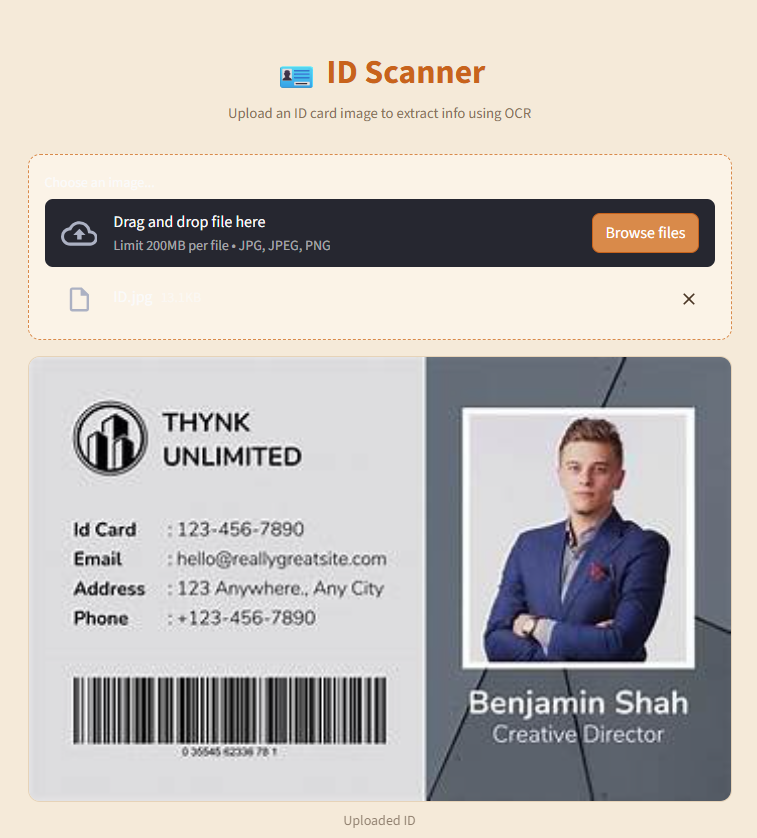
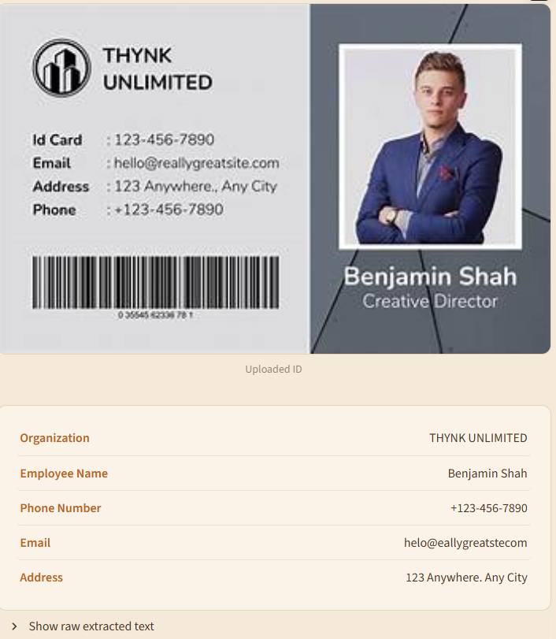

<div align="center">

# ID Scanner OCR

**Extract structured data from ID card images — instantly, in your browser.**

[](https://www.python.org/)
[](https://streamlit.io/)
[](https://github.com/tesseract-ocr/tesseract)
[](LICENSE)

</div>

---

## Overview

**ID Scanner OCR** is a lightweight Streamlit app that reads an uploaded ID/badge
image, runs it through **Tesseract OCR**, and parses the raw text into clean,
structured fields — Organization, Name, Phone, Email, Address — using
keyword-anchored regex instead of brittle fixed line positions, so it holds up
across different card layouts.

<div align="center">
  
  
</div>

## Features

- Drag-and-drop image upload (`.jpg`, `.jpeg`, `.png`)
- OCR text extraction via `pytesseract`
- Keyword-anchored field parsing (`Phone:` / `Email:` / `Address:`) instead
  of fragile fixed line indices — survives OCR line-splitting differences
- Clean, custom-styled UI with subtle hover states
- Expandable raw-OCR-text view for debugging extraction
- Graceful fallback (`—`) for any field OCR couldn't find

## Tech Stack

| Layer         | Tool                                      |
|---------------|--------------------------------------------|
| UI            | [Streamlit](https://streamlit.io/)         |
| OCR Engine    | [Tesseract](https://github.com/tesseract-ocr/tesseract) via `pytesseract` |
| Image Handling| `Pillow`, `NumPy`                          |
| Parsing       | Python `re` (regex, keyword-anchored)      |

## Installation

### 1. Clone the repo
```bash
git clone https://github.com/<your-username>/id-scanner-ocr.git
cd id-scanner-ocr
```

### 2. Install Tesseract OCR (system dependency)

| OS      | Command |
|---------|---------|
| Windows | Download installer from [UB-Mannheim/tesseract](https://github.com/UB-Mannheim/tesseract/wiki) |
| macOS   | `brew install tesseract` |
| Linux   | `sudo apt install tesseract-ocr` |

> On Windows, Tesseract isn't on `PATH` by default. Either install to the
> default location (`C:\Program Files\Tesseract-OCR\tesseract.exe`), or set
> the `TESSERACT_CMD` environment variable to your install path.

### 3. Install Python dependencies
```bash
python -m venv venv
source venv/bin/activate   # Windows: venv\Scripts\activate
pip install -r requirements.txt
```

### 4. Run the app
```bash
streamlit run app.py
```

The app opens at `http://localhost:8501`.

## Project Structure

```
id-scanner-ocr/
├── app.py              # Streamlit app: UI, OCR call, field parsing
├── requirements.txt    # Python dependencies
├── assets/             # README screenshots
├── LICENSE
├── .gitignore
└── README.md
```

## Known Limitations

- OCR accuracy depends entirely on image quality — low-res or skewed photos
  will produce noisier text and may leave some fields blank.
- Name vs. job-title detection is a heuristic (regex on capitalization
  pattern), not true NLP — unusual name formats may be misread.
- No image preprocessing (deskew/threshold) yet — planned improvement below.

## Roadmap

- [ ] Image preprocessing (grayscale, thresholding, deskew) before OCR
- [ ] Multi-language OCR support
- [ ] Export extracted fields to CSV/JSON
- [ ] Confidence scores per field

## License

Released under the [MIT License](LICENSE).

---